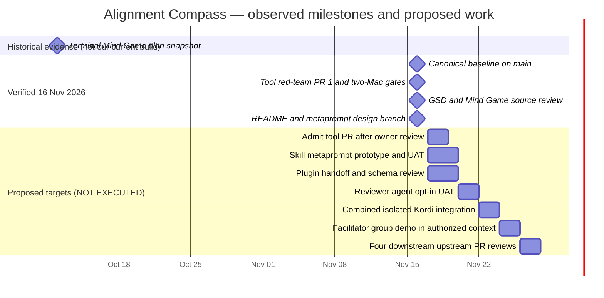

# Kordi Alignment Compass — implementation Gantt and acceptance gates

**As of 2026-11-16 (America/Los_Angeles).** This is a deliberately mixed **verified chronology + proposed planning window**. Actual dates apply only to inspected source or observed GitHub events. Dates after November 16 are **illustrative targets, not approved commitments or evidence of execution**.

## Chronology (inspectable evidence only)

| Date | Lane | Recorded event | Evidence/claim ceiling |
| --- | --- | --- | --- |
| 2026-10-12 | Historical game | Earlier private Mind Game master plan dated this day | SOURCE_REVIEWED; not a Kordi execution |
| 2026-11-16 | Framework | Canonical repository initial commit `4bde9731e0e32a68d7174590e78bbdb6cc906099` | IMPLEMENTED baseline files |
| 2026-11-16 | Tool | [PR #1](https://github.com/biobitworks/kordi-alignment/pull/1) with tests, negative findings and two-machine receipts | EXECUTED offline; PR not merged |
| 2026-11-16 | Documentation | Reviewed GSD Core next at `699efee16144f23af1dea2a811983265c4b2994f` and the earlier terminal alignment logic | SOURCE_REVIEWED; no copied code |
| 2026-11-16 | Skill design | README, GSD-inspired metaprompt and historical crosswalk drafted on a documentation branch | IMPLEMENTED DOCS; Kordi skill runtime NOT_TESTED |

## Responsibilities and dependencies

| Lane | Owner | Starting state | Acceptance gate | May run concurrently? |
| --- | --- | --- | --- | --- |
| **Tool** | Tool/red-team lane | PR #1 open; source hardened and tested | Peer review, CI, merge into main; version/contract freeze | Yes |
| **Skill** | Skill teammate | Initial SKILL.md exists; metaprompt DESIGN proposed | Validate proposed JSON contract; safe abstention and actual isolated model UAT | Yes, against pinned tool contract |
| **Plugin** | Plugin teammate | Initial JS adapter exists | Real local host integration, fail-closed 403 behavior, schema parity and Kordi discovery check | Yes, against pinned tool contract |
| **Agent** | Agent teammate | Reviewer prompt exists, autonomous agent NOT_DEPLOYED | User opt-in, no hidden background work, actual isolated agent UAT | Yes, after skill contract stabilizes |
| **Integrator** | Human owner/facilitator | No live group integration evidenced | Combined test and recorded approval before upstream exports | After upstream dependencies pass |

**Critical dependencies:** Tool contract → plugin invocation/schema → skill activation → optional agent UAT → combined isolated integration → human-approved upstream PRs. Documentation and red-team plans can proceed in parallel with teammate implementation. **No automatic promotion or merge.**

## Model/evidence gate ledger

| Gate | Implemented | Executed | Observed | Supported claim |
| --- | --- | --- | --- | --- |
| Original canonical code and initial README | Yes | Offline Node checks | PASS in earlier execution | Baseline implemented, not product-deployed |
| Tool hardening PR #1 | Yes on PR branch | Node, Python differential, 20k synthetic, local plugin host on both Macs | PASS; explicit predecessor failures retained | Offline deterministic and adapter behavior only |
| GSD metaprompt design | Documentation only | Source review; schema/example validation planned here | NOT_TESTED as running Kordi skill | Specification, not a GSD installation |
| Historical Mind Game integration | Crosswalk only | Old source inspected; no game run executed now | Not computed for Kordi | Design correspondence, with boundary mismatch |
| Teammate LLM prompt red team | Proposed | NOT_TESTED | UNKNOWN | No runtime instruction-following assertion |
| Live Kordi app/cloud + 403 root cause | Unchanged | No signed-in test | UNKNOWN | Running desktop process is not a functional integration result |

## Changes allowed in this documentation lane

The docs contributor may edit README, `meta/`, and `docs/`, and validate generated schemas. Do **not** edit teammate-owned `skills/`, `extensions/`, `agents/` or `prompts/` in this branch. Do **not** merge tool PR #1 without independent review. Every later Gantt status update should link a real PR, commit or execution receipt, preserving predecessor outcomes.

**Next review:** canonical README/metaprompt PR first; human confirms skill plan; teammates publish separate PRs; CI and red-team receipts are compared before integrated local testing.
